# Audit RAAM 1.1 – CEJ Android avec TalkBack – 14 octobre 2026

## 1. Contexte

| | |
|---|---|
| Application | CEJ staging (`fr.fabrique.social.gouv.passemploi.staging`), build debug de la branche `fix/a11y-audit-raam-android` à `d59262e28`, installée le 14/10 à 15:48 |
| Appareil | AVD Android 14, 1080 × 1920, 420 dpi, langue système **fr-FR** pendant l'audit |
| Lecteur d'écran | TalkBack 12.2 (Android Accessibility Suite), réglages par défaut |
| Comptes | Mission Locale « Test » (parcours 1), puis « MALEK » (parcours 2 et 3) |
| Référentiel | [RAAM 1.1](https://accessibilite.public.lu/fr/raam1.1/referentiel-technique.html) |

Parcours audités :

1. Modification du plan d'action depuis l'onglet **Accueil** (pistes, cases à cocher, déclaration, questionnaire, « Modifier ») ;
2. Création d'une action depuis l'onglet **Agenda** (3 étapes et confirmation) ;
3. Recherche d'offre dans l'onglet **Offres** (formulaire, saisie Métier, résultats, filtres, fiche détail).

### Méthode

- Gestes TalkBack réels : balayage droite/gauche, double-tap, exploration au toucher. Ils sont envoyés comme touchers à l'émulateur via sa console (`event mouse`), car `adb shell input` contourne TalkBack.
- Annonces lues dans l'option développeur TalkBack « Afficher la sortie vocale ». Une capture est prise environ 0,35 s puis 1,3 s après chaque geste, et plus longtemps quand c'est utile. Le cadre vert sur les captures marque le focus TalkBack.
- Arbre d'accessibilité complet obtenu par le dump sémantique Flutter (`flutter run`, touche `S`), puis analyse du code.
- Pour les corrections du premier audit : texte à 200 %, paysage, clavier (Tab simulé par `adb shell input keyevent 61`) et appareil repassé en en-US.

### Lire les captures

À gauche : l'écran au moment du geste, avec le focus TalkBack en vert. À droite : le bandeau de sortie vocale de TalkBack (gris foncé, au-dessus de la barre de navigation) à plusieurs instants, avec une légende rouge.

### Limites

- L'API staging a répondu **500** à `/offres-emploi` pour la recherche « Emploi ». L'état d'erreur a donc été audité ; la liste de résultats l'a été sur une recherche « Alternance » (1 offre).
- La validation du formulaire de déclaration du plan a échoué côté serveur. Le message d'erreur a été audité, l'écran de succès ne l'a pas été.
- Non traités : contrastes et couleurs (thème 2) ; multimédia, tableaux, documents (thèmes 3, 4, 11.3–11.4), sans objet sur ces parcours.
- Données modifiées sur les comptes de test :
  - compte « Test » : une action du plan supprimée, une autre décochée, une contrainte « Pas de permis » ajoutée au questionnaire ;
  - compte « MALEK » : action « Candidature » créée au 14/10, favori ajouté puis retiré, étapes du questionnaire passées.

## 2. Synthèse des résultats par critère

C = conforme, NC = non conforme, NA = non applicable, NT = non testé. Un critère est NC dès qu'un écran l'est.

| Critère | Statut | Écrans non conformes |
|---|---|---|
| 1.1 Images décoratives ignorées | C | – |
| 5.1 Composants compatibles (nom, rôle, état) | **NC** | Accueil, Créer une action, Déclaration, saisie Métier, Fiche offre |
| 5.3 Changement de contexte | **NC** | Questionnaire |
| 5.4 Messages de statut | **NC** | Résultats de recherche, Confirmation de création |
| 5.5 État des contrôles à bascule | **NC** | Accueil (accordéons) |
| 6.1 Langue de restitution | C | – |
| 7.1 Titres | **NC** | Déclaration, Avant de continuer, Confirmation, Formulaire de recherche, saisie Métier |
| 7.2 Listes | **NC** | Fiche offre |
| 8.1 Contenu visible restitué | C | – |
| 8.2 Texte agrandi à 200 % | **NC** | Barre d'onglets, Agenda, Créer une action |
| 8.5 Focus visible | **NC** | Résultats (clavier), Créer une action (TalkBack) |
| 9.1 à 9.3 Étiquettes de champs | **NC** (9.3) | Formulaire de recherche |
| 9.7 Champs obligatoires | C | – |
| 9.9 Erreurs de saisie | **NC** | Créer une action |
| 10.1 Ordre de tabulation | C | – |
| 10.2 Ordre de restitution / gestion du focus | **NC** | Questionnaire, Avant de continuer, Déclaration, Créer une action, Résultats |
| 11.8 Contenu en mouvement | C | – |
| 11.9 Orientation | C | – |
| 2.x, 3.x, 4.x, 11.1–11.7, 11.10–11.16, 12.x | NT / NA | – |

## 3. Détail par critère

### 1.1 Éléments graphiques de décoration – C

| Écran | Annonce constatée | Capture |
|---|---|---|
| Accueil, accordéons du plan | Emoji d'objectif (🧭…) non lu : « Je cherche à m'orienter, 0 actions faites sur 15, Bouton » | [p1-02](captures/2026-10-14/p1-02-accordeon-sans-etat.png) |
| Questionnaire, Créer une action | Emojis des tuiles et des cases ignorés : « Emploi. Recherches, candidatures, Bouton » | [p2-03](captures/2026-10-14/p2-03-etape1-focus.png) |

### 5.1 Composants d'interface compatibles avec les technologies d'assistance – NC

#### a) Liens sans rôle ni consigne d'activation (Accueil, Fiche offre)

| Écran | Annonce constatée | Annonce attendue |
|---|---|---|
| Accueil, action du plan avec service | « La Bonne Boîte » | « La Bonne Boîte, Lien » ou « …, Bouton, ouvre le site dans le navigateur » |
| Fiche offre, « Je postule » | « Je postule », sans rôle ni « Appuyer deux fois pour activer » | « Je postule, Lien, ouvre le site de l'employeur » |

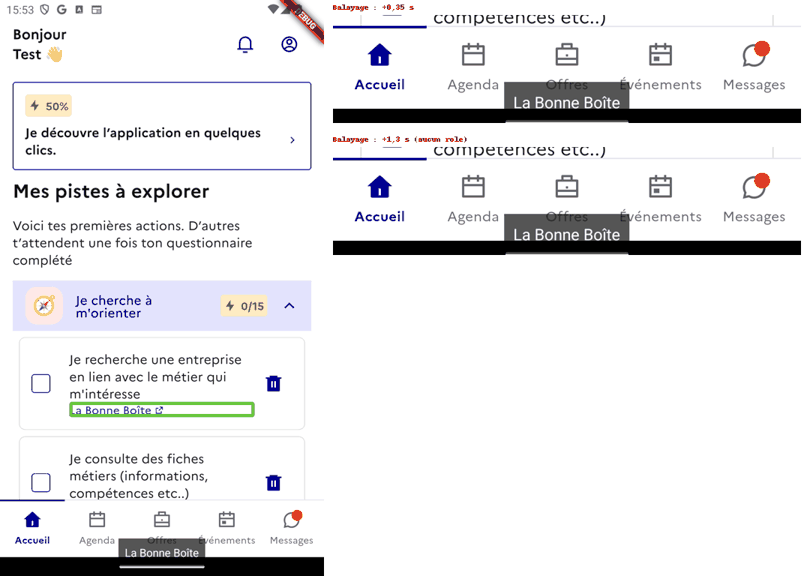
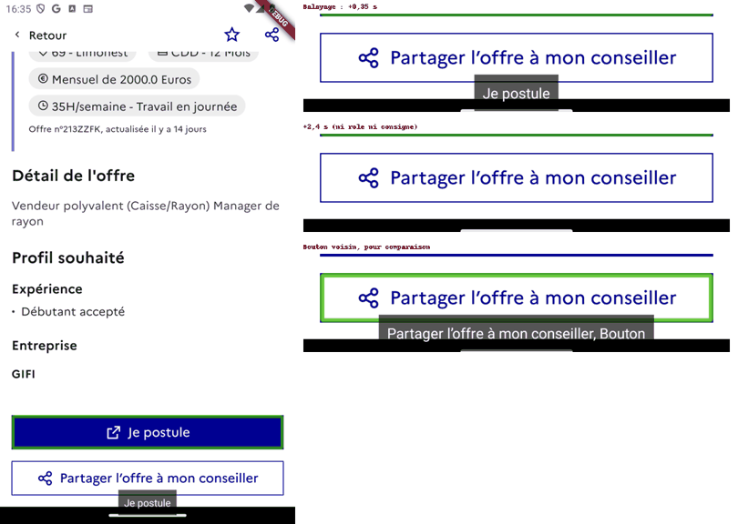

Le dump montre bien `flags: isLink`, mais TalkBack 12.2 avec le moteur Flutter 3.35 ne restitue ni le rôle « Lien » ni la consigne d'activation. Le bouton voisin « Partager l'offre à mon conseiller » est, lui, annoncé « Bouton ».

**Piste de correction** : sur Android, exposer `button: true` (rôle restitué) et indiquer l'ouverture externe dans `hint`. Le mieux est un composant partagé, utilisé aux deux endroits :
- [invite_action_plan_section.dart:344](../../lib/pages/accueil/invite/invite_action_plan_section.dart#L344)
- [offre_details_actions_footer.dart:71-77](../../lib/widgets/offre_details/offre_details_actions_footer.dart#L71-L77)

À revérifier avec TalkBack après correction.

#### b) Favori de la fiche offre sans nom d'offre (Fiche offre)

| Annonce constatée | Annonce attendue |
|---|---|
| « Enregistrer l'offre  , Bouton » (nom vide) | « Enregistrer l'offre ALT Vendeur polyvalent…, Bouton » (comme sur la carte de résultat) |

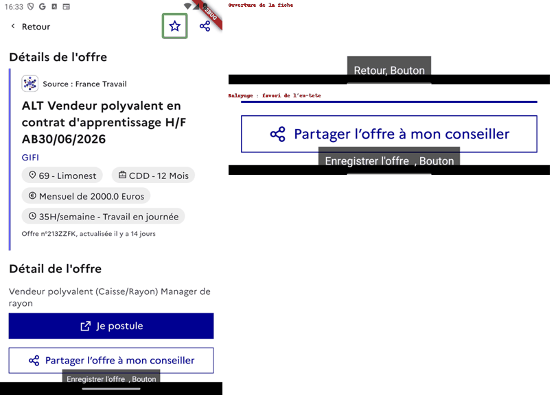

**Piste de correction** : passer `a11yLabel: title` au `FavoriHeart` de la fiche ([offre_emploi_details_page.dart:105](../../lib/pages/offre_emploi/offre_emploi_details_page.dart#L105)). La valeur par défaut `' '` ([favori_heart.dart:32](../../lib/widgets/favori_heart.dart#L32)) produit ce libellé vide.

#### c) Message d'erreur fusionné avec le bouton « Dicter » (Créer une action, Déclaration)

| Annonce constatée | Annonce attendue |
|---|---|
| Un seul nœud « La description est obligatoire, Dicter, Bouton » qui couvre tout le bloc, puis « Zone de modification, Décrire mon action… » sans l'erreur | « Zone de modification, Décrire mon action…, erreur : la description est obligatoire », puis « Dicter, Bouton » |

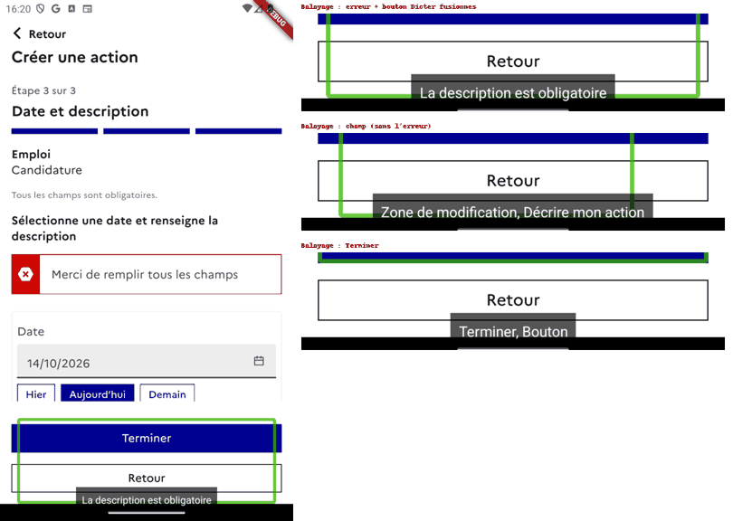

Cause : le `Semantics(container: true)` qui enveloppe le champ et ses boutons absorbe le bouton « Dicter » (rôle et libellé) et le texte d'erreur dans un même nœud.

**Piste de correction** : ajouter `explicitChildNodes: true` sur ce `Semantics` ([create_user_action_form_step2.dart:269-270](../../lib/pages/user_action/create/create_user_action_form_step2.dart#L269-L270)), ou donner un `container: true` à chaque bouton. Il faut aussi rattacher l'erreur au champ (voir 9.9). La même correction règle l'ordre décrit en 10.2 c.

#### d) Titre de section et suggestion fusionnés (saisie Métier)

Le dump montre un nœud unique `isButton, isHeader` dont le libellé est « Recherches récentes ↵ Vendeur ». Le titre devient activable et la suggestion devient un titre.

**Piste de correction** : `container: true` sur le `Semantics(header)` et sur le `Semantics(button)` ([autocomplete_suggestions_group.dart:37](../../lib/widgets/text_form_fields/utils/autocomplete_suggestions_group.dart#L37) et [:88](../../lib/widgets/text_form_fields/utils/autocomplete_suggestions_group.dart#L88)).

#### e) Points mineurs

- Le voile des feuilles modales est annoncé « Fermer la boîte de dialogue, bouton » : le mot « bouton » est écrit dans le libellé ([strings.dart:2123](../../lib/ui/strings.dart#L2123)). Supprimer `$buttonRole` ; le rôle doit venir de la sémantique.
- Les feuilles modales sont annoncées « Boîte de dialogue » (nom générique de Material), jamais par leur titre.

#### Conforme sur ces parcours

- Cases du plan : « non coché, Je recherche une entreprise…, Ouvre le formulaire de déclaration, Case à cocher » ([p1-03](captures/2026-10-14/p1-03-case-a-cocher.png)).
- Corbeille : « Supprimer l'action …, Bouton » ; curseur de distance : « 10 kilomètres, Dans un rayon de recherche, Minimum 0 kilomètres, maximum 100 kilomètres, Curseur » ([p3-11](captures/2026-10-14/p3-11-filtres.png)).
- Cartes d'offre ([p3-09](captures/2026-10-14/p3-09-carte-offre.png)) et « Mes outils » annoncés « Bouton ».

### 5.3 Changement de contexte – NC (Questionnaire)

Le questionnaire est rouvert depuis l'Accueil par « Reprendre le questionnaire » ou par « Modifier » puis « Passer cette étape ». Dans ce cas, revenir en arrière jusqu'à l'étape 1, puis faire encore « Retour » (bouton ou geste retour système), **déconnecte l'utilisateur** sans avertissement : l'écran « Choisis un compte » s'affiche.

C'est ce qui s'est produit pendant l'audit vers 16 h 10 : il a fallu se reconnecter avec un autre compte. Pas de capture conservée.

| Comportement constaté | Comportement attendu |
|---|---|
| Retour à l'étape 1 → `RequestLogoutAction` | Retour à l'Accueil (questionnaire ouvert depuis l'app), ou au minimum une confirmation avant déconnexion |

**Piste de correction** : `_onBack` déconnecte dès que `editMode` est faux ([onboarding_questionnaire_page.dart:126-140](../../lib/pages/onboarding_questionnaire/onboarding_questionnaire_page.dart#L126-L140)). Or la reprise depuis l'Accueil passe par le routeur avec `editMode: false` ([router_page.dart:87](../../lib/pages/router_page.dart#L87)). Il faut distinguer le premier parcours d'entrée de la reprise depuis l'Accueil, ou demander confirmation.

### 5.4 Messages de statut – NC

#### a) Résultats de recherche : chargement, nombre de résultats et erreur non annoncés

| Moment | Annonce constatée | Annonce attendue |
|---|---|---|
| Après « Rechercher » | « Offres d'emploi, Titre » ; le chargement n'est pas annoncé | « Chargement des offres » |
| Échec de l'API | Rien, alors que l'écran affiche « Une erreur s'est produite » | « Une erreur s'est produite. Une erreur est survenue. Réessaie » |
| Résultats chargés | Rien : « 1 offre » n'est lu que si l'on balaie jusqu'à lui | « 1 offre » annoncé au chargement |

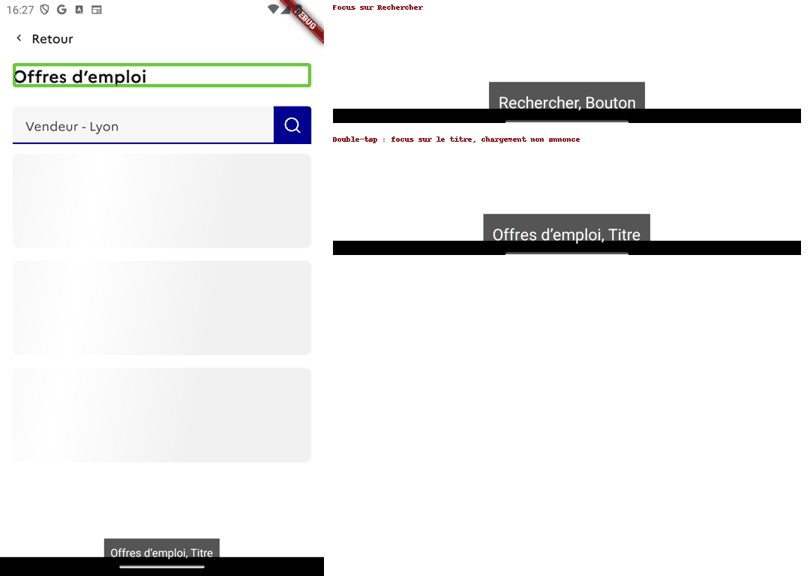
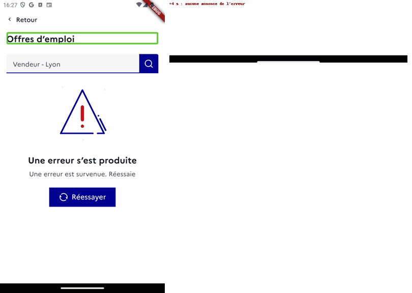

**Piste de correction** : `A11yUtils.announce` sur les transitions d'état de `BlocResultatRecherche` ([bloc_resultat_recherche.dart:72-92](../../lib/widgets/recherche/bloc_resultat_recherche.dart#L72-L92)), en annonçant `resultsCountLabel` ([resultat_recherche_contenu.dart:64](../../lib/widgets/recherche/resultat_recherche_contenu.dart#L64)) et le texte de `Retry`.

#### b) Confirmation de création d'action non lue

| Annonce constatée | Annonce attendue |
|---|---|
| Le focus va directement sur « Consulter mon action, Bouton ». « Action terminée », « Bravo, MALEK ! » et « L'action « Candidature », est enregistrée » ne sont jamais lus. | « Bravo, MALEK !, Titre », puis le message de confirmation |

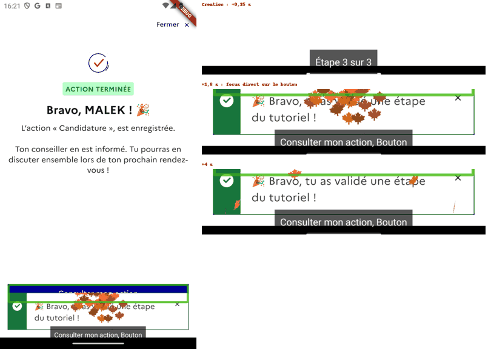

**Piste de correction** : placer l'`AutoFocusA11y` sur le titre (balisé comme titre) plutôt que sur le bouton ([create_user_action_confirmation_page.dart:144-148](../../lib/pages/user_action/create/create_user_action_confirmation_page.dart#L144-L148) et [:195-215](../../lib/pages/user_action/create/create_user_action_confirmation_page.dart#L195-L215)), ou annoncer titre et sous-titre à l'affichage.

#### Conforme sur ces parcours

- Suppression d'une piste : « Action J'effectue une recherche d'emploi… supprimée » ([p1-05](captures/2026-10-14/p1-05-suppression-annoncee.png)).
- « Merci de remplir tous les champs » annoncé à la validation : correction du 1er audit vérifiée ([p2-05](captures/2026-10-14/p2-05-erreur-globale.png)).
- Erreur serveur de la déclaration annoncée : « Une erreur est survenue. Réessaie » ([p1-10](captures/2026-10-14/p1-10-erreur-declaration.png)).

**Remarque, non bloquante** : décocher une piste ne produit aucune annonce. Le bandeau garde « coché, … », et le nouvel état n'est lu que si l'on revient sur la case ([p1-11](captures/2026-10-14/p1-11-decocher-sans-annonce.png)). Le même silence a été observé en cochant une contrainte du questionnaire. On peut annoncer « non coché » / « coché » après bascule, comme pour la suppression.

### 5.5 État des contrôles à bascule – NC (Accueil)

#### Accordéons d'objectifs du plan

| Annonce constatée | Annonce attendue |
|---|---|
| « Je cherche à m'orienter, 0 actions faites sur 15, Bouton », sans état. Après double-tap, le contenu se déplie sans aucune annonce. | « …, Bouton, réduit », puis « développé » après activation |

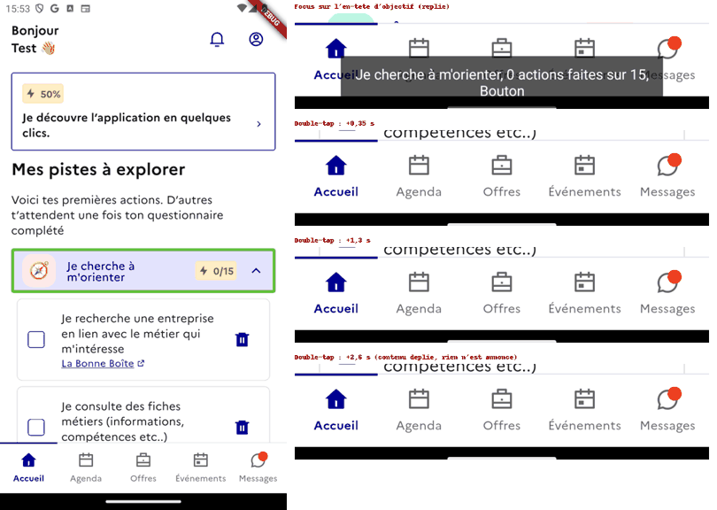

Le code positionne bien `expanded: _expanded` ([invite_action_plan_section.dart:112](../../lib/pages/accueil/invite/invite_action_plan_section.dart#L112)). Mais le moteur Android de Flutter 3.35 n'exploite pas ce drapeau : `AccessibilityBridge` ne contient aucun `setExpanded` ni `ACTION_EXPAND`. VoiceOver le restitue, TalkBack non.

**Piste de correction** : sur Android, porter l'état dans `value` (« Développé » / « Réduit ») et l'annoncer au basculement (`A11yUtils.announce`). Cette solution de contournement restera nécessaire tant que le moteur ne gère pas `expanded`.

#### Conforme sur ces parcours

- Cases à cocher (« coché / non coché »).
- Onglets internes : « sélectionné, Recherche », « Onglet 1 sur 3 » ([p3-01](captures/2026-10-14/p3-01-onglets-offres.png)).
- Barre d'onglets : « sélectionné, Agenda, Bouton » ([p2-01](captures/2026-10-14/p2-01-onglet-agenda.png)).
- Favori : le libellé passe à « Retirer l'offre … des offres suivies » ([p3-10](captures/2026-10-14/p3-10-favori-etat.png)).
- Suggestions de date : « sélectionné, Aujourd'hui (14 octobre 2026), Bouton ». Correction du 1er audit vérifiée ([p1-09](captures/2026-10-14/p1-09-date-selectionnee.png), [p2-10](captures/2026-10-14/p2-10-date-selectionnee.png)).
  - Remarque : juste après le double-tap, TalkBack relit le libellé sans « sélectionné » ; l'état n'est lu qu'au retour du focus.

### 6.1 Langue de restitution – C

L'appareil a été repassé en en-US, puis la feuille « Filtrer les annonces » ouverte. Le dump restitue toujours « Boîte de dialogue » et « Fermer la boîte de dialogue », et non « Dialog » / « Dismiss ». La correction du 1er audit (français seul déclaré) est vérifiée.

### 7.1 Titres – NC

| Écran | Annonce constatée | Annonce attendue | Correction |
|---|---|---|---|
| Feuille de déclaration | « Je recherche une entreprise en lien avec le métier qui m'intéresse » | « …, Titre » | `Semantics(header: true)` sur le titre, [action_plan_declaration_bottom_sheet.dart:96-99](../../lib/widgets/bottom_sheets/action_plan_declaration_bottom_sheet.dart#L96-L99) |
| Feuille « Avant de continuer » | « Avant de continuer » | « Avant de continuer, Titre » | [action_plan_feedback_bottom_sheet.dart:40-43](../../lib/widgets/bottom_sheets/action_plan_feedback_bottom_sheet.dart#L40-L43) |
| Confirmation de création | « Bravo, MALEK ! 🎉 » (dump : pas de `isHeader`) | « …, Titre » | [create_user_action_confirmation_page.dart:144](../../lib/pages/user_action/create/create_user_action_confirmation_page.dart#L144) |
| Formulaire de recherche | « Recherches récentes » | « Recherches récentes, Titre » (comme sur la page de saisie Métier) | [recherche_criteres_full_screen.dart:136-139](../../lib/widgets/recherche/recherche_criteres_full_screen.dart#L136-L139) |
| Saisie Métier | Titre fusionné avec la suggestion (voir 5.1 d) | – | – |

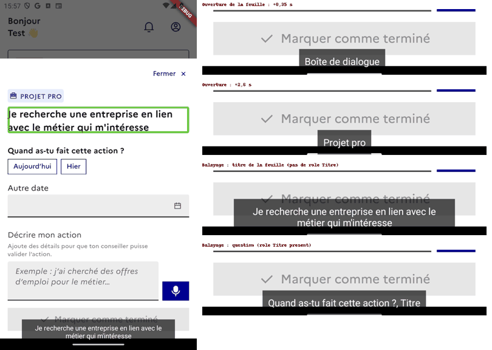
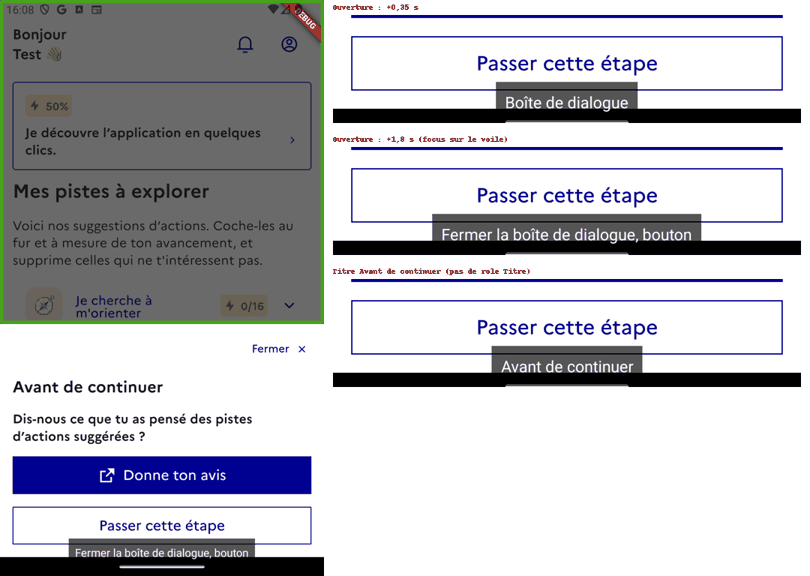
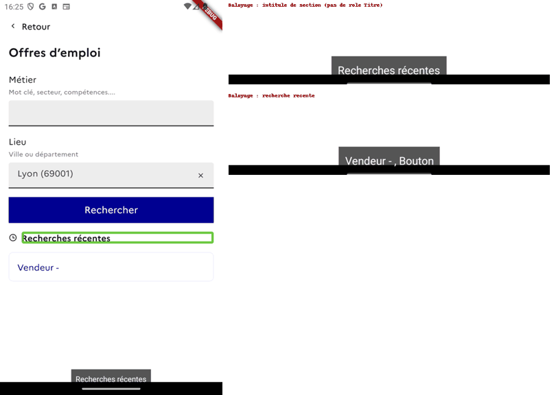

**Conforme** :
- « Mes pistes à explorer, Titre » ([p1-01](captures/2026-10-14/p1-01-titre-pistes.png)) ;
- « Agenda, Titre » ;
- « Choisis une thématique, Titre », « Choisis une catégorie, Titre » ;
- « Offres, Titre », « Explorer par type, Titre », « Offres d'emploi, Titre », « 1 offre, Titre » ;
- titres de la fiche offre (« Détail de l'offre », « Profil souhaité »…) ;
- « Filtrer les annonces, Titre ».

### 7.2 Listes – NC (Fiche offre)

| Annonce constatée | Annonce attendue |
|---|---|
| « Puces », puis « Débutant accepté » : la puce « • » est un arrêt à part | « Débutant accepté » (éventuellement « liste, 1 élément ») |

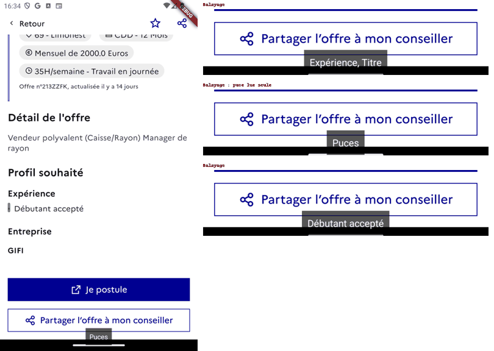

**Piste de correction** : `ExcludeSemantics` autour du `Text('•')`, comme dans [suppression_compte_page.dart:130](../../lib/pages/suppression_compte_page.dart#L130) ([offre_emploi_details_page.dart:417-420](../../lib/pages/offre_emploi/offre_emploi_details_page.dart#L417-L420) et [:439-442](../../lib/pages/offre_emploi/offre_emploi_details_page.dart#L439-L442)).

### 8.1 Contenu visible accessible – C

- Cartes de l'Agenda (correction 13019948e) :
  - action : « mercredi 14 oct. Action Emploi J'effectue une recherche d'emploi sur Welcome to the jungle Statut : Terminée » ;
  - rendez-vous : « jeudi 15 oct. Information collective Atelier cv 12 heures 13 - 17 heures 13 ».
  - Les statuts « Annulé » et d'inscription n'étaient pas présents dans les données : non testés.
- Carte de progression du questionnaire : « Profil complété, 7 étapes sur 8 ».

**Remarque** : la carte d'heures de l'Agenda est lue en 5 arrêts (« Objectif dépassé ! Bravo 👏 », « 20H », « réalisée », « 0H », « validée »). Il faudrait regrouper en « 20 heures réalisées, 0 heure validée » avec un `MergeSemantics` par statistique ([comptage_des_heures_card.dart:104-131](../../lib/widgets/comptage_des_heures_card.dart#L104-L131), [p2-02](captures/2026-10-14/p2-02-carte-objectif-fragmentee.png)).

### 8.2 Texte agrandi à 200 % – NC

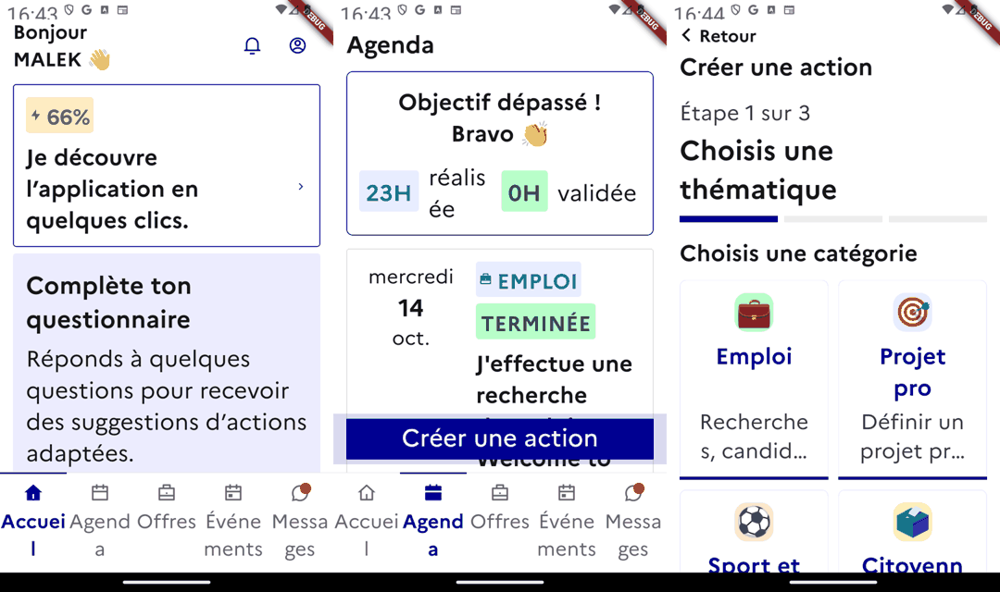

| Écran | Constat | Piste de correction |
|---|---|---|
| Barre d'onglets (tous écrans) | Les libellés passent sur deux lignes mais sont coupés en milieu de mot : « Accuei/l », « Agend/a », « Messa/ges », « Événe/ments » | Autoriser une police plus petite pour ces libellés (`MediaQuery.withClampedTextScaling`, max 1,5), ou masquer les libellés au-delà d'un seuil en gardant le nom accessible ([dsfr_bottom_navigation.dart:160](../../lib/widgets/dsfr/dsfr_bottom_navigation.dart#L160)) |
| Agenda, carte d'heures | « réalis/ée » coupé en milieu de mot | Passer la statistique en colonne (badge au-dessus du libellé) quand le texte est agrandi ([comptage_des_heures_card.dart:117-131](../../lib/widgets/comptage_des_heures_card.dart#L117-L131)) |
| Créer une action, tuiles de catégorie | Sous-titres tronqués : « Recherche s, candid… », « Définir un projet pr… » | Lever `maxLines` / `ellipsis` des sous-titres quand le texte est agrandi ([emoji_solution_tile.dart:39-40](../../lib/widgets/dsfr/emoji_solution_tile.dart#L39-L40)) |

**Corrections du 1er audit vérifiées** :
- bouton « Retour » de « Créer une action » dimensionné selon le texte (3e panneau ci-dessus) ;
- carte d'objectif qui défile avec la liste, colonne « mercredi » non coupée, y compris en paysage ([capture](captures/2026-10-14/v-8-2-agenda-defilement-paysage.png)).

### 8.5 Prise de focus visible – NC

| Écran | Constat | Piste de correction |
|---|---|---|
| Résultats de recherche (clavier) | Après le champ « Vendeur - Lyon », un Tab s'arrête sur la loupe, sans indicateur visible. C'est un second arrêt, sans nom, pour la même action. | `canRequestFocus: false` sur le second `InkWell` ([edit_criteres_button.dart:123](../../lib/widgets/recherche/edit_criteres_button.dart#L123)) |
| Créer une action, étape 3 (TalkBack) | Le bloc « Décrire mon action » et son erreur reçoivent le focus sous les boutons fixes « Terminer / Retour » : le cadre de focus est masqué | Placer les boutons en `bottomNavigationBar` du `Scaffold` plutôt qu'en `Stack`, pour que la zone défilante s'arrête au-dessus ([create_user_action_form.dart:82-95](../../lib/pages/user_action/create/create_user_action_form.dart#L82-L95)) |

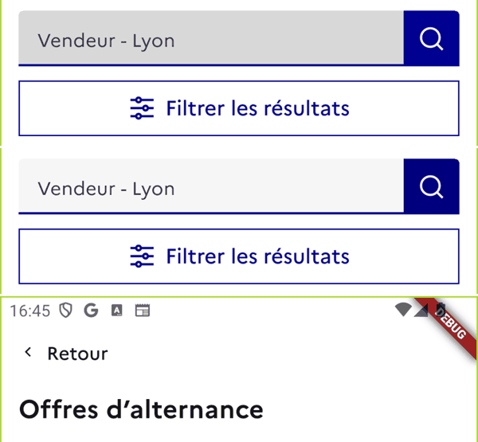

En haut, Tab sur le champ (fond gris) ; au milieu, Tab suivant sur la loupe (rien de visible).

### 9.1 à 9.3 Étiquettes des champs – NC (9.3, mineur)

| Écran | Annonce constatée | Annonce attendue |
|---|---|---|
| Formulaire de recherche, Métier | « Métier, Mot clé, secteur, compétences4 Point, Bouton » | « Métier, Mot clé, secteur, compétences…, Bouton » |

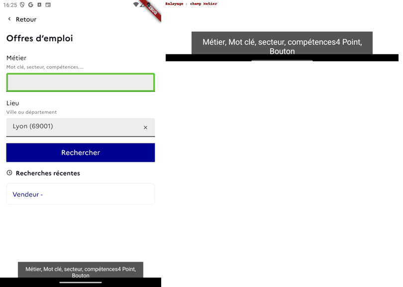

**Piste de correction** : remplacer « .... » par « … » ou supprimer les points ([strings.dart:1291](../../lib/ui/strings.dart#L1291)).

**Conforme** :
- « Lieu, Ville ou département, Valeur choisie : Lyon (69001), Bouton » ;
- saisie Métier : « Zone de modification, Métier Saisis un mot clé… » ([p3-03](captures/2026-10-14/p3-03-saisie-metier.png)) ;
- « Texte : Autre date » (correction 9.2 du 1er audit vérifiée) ;
- « Zone de modification, Décrire mon action » ; « Date ».

### 9.7 Champs obligatoires – C

« Tous les champs sont obligatoires. » et « Sélectionne une action (obligatoire), Titre » ([p2-04](captures/2026-10-14/p2-04-etape2-puces.png)).

### 9.9 Erreurs de saisie – NC (Créer une action)

| Champ | Annonce constatée | Annonce attendue |
|---|---|---|
| Date | « Date » / « Texte : Date », puis « La date est obligatoire » lu comme un texte à part | « Date, erreur : la date est obligatoire » |
| Description | Erreur lue avec le bouton « Dicter » (voir 5.1 c) ; le champ n'annonce pas l'erreur | « Décrire mon action, erreur : la description est obligatoire » |

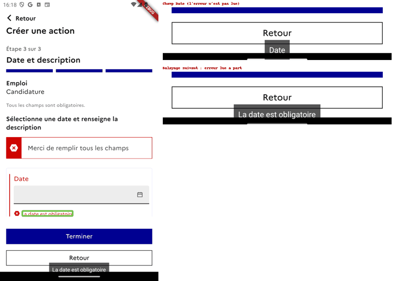

**Pistes de correction** :
- Description : intégrer `errorMessage` au libellé ou au `hint` du champ ([create_user_action_form_step2.dart:268-288](../../lib/pages/user_action/create/create_user_action_form_step2.dart#L268-L288)).
- Date : le composant vient de `flutter_dsfr` (`DsfrDateInput`, `Semantics(label)` sans l'erreur). Le corriger en amont, ou envelopper l'appel avec un `hint` qui porte l'erreur ([create_user_action_form_step3.dart:243-255](../../lib/pages/user_action/create/create_user_action_form_step3.dart#L243-L255)).

Le message global « Merci de remplir tous les champs » est, lui, conforme (voir 5.4).

### 10.1 Ordre de tabulation – C

Résultats de recherche, au clavier : Retour → champ de recherche → (loupe, voir 8.5) → Filtrer les résultats → carte d'offre → favori → Créer une alerte. La liste n'est plus un arrêt de tabulation : correction du 1er audit vérifiée.

Non testé : la séparation contenu / barre du bas en deux groupes de tabulation, sur les écrans à onglets.

### 10.2 Ordre de restitution et gestion du focus – NC

| Écran | Constat | Annonce attendue | Piste de correction |
|---|---|---|---|
| Questionnaire, ouverture depuis l'Accueil | Focus sur « Retour, Bouton », l'étape n'est pas annoncée ([p1-12](captures/2026-10-14/p1-12-questionnaire-ouverture.png)) | « Étape 8 sur 8, Quelles sont tes contraintes ?, Titre » | Voir ci-dessous |
| Questionnaire, « Passer cette étape » / retour système | Le focus reste sur « Passer cette étape », la nouvelle étape n'est jamais annoncée ([p1-13](captures/2026-10-14/p1-13-questionnaire-changement-etape.png)) | « Étape 5 sur 8, Comment peut-on t'aider ?, Titre » | Voir ci-dessous |
| Feuille « Avant de continuer » | « Boîte de dialogue », puis focus sur le voile « Fermer la boîte de dialogue, bouton », hors de la feuille ([p1-14](captures/2026-10-14/p1-14-feuille-avis.png)) | Focus sur « Avant de continuer, Titre » | `AutoFocusA11y` sur le titre (balisé comme titre) de chaque feuille, ou dans `DsfrBottomSheet` |
| Feuille de déclaration, champ vide | « Dicter, Bouton » est lu **avant** « Zone de modification, Décrire mon action » ([p1-08](captures/2026-10-14/p1-08-dicter-avant-champ.png)) | Champ, puis Dicter | Même correction que 5.1 c |
| Résultats, « Réessayer » | Le bouton disparaît et le focus retombe sur « Retour » en haut de page ([p3-07](captures/2026-10-14/p3-07-reessayer-focus-perdu.png)) | Focus sur le titre ou annonce du nouvel état | Voir 5.4 a |
| Agenda, bandeau tutoriel | Au retour de la confirmation, le focus est sur la croix du bandeau ; après fermeture, il saute à « Aller à aujourd'hui » ([p2-09](captures/2026-10-14/p2-09-bandeau-tutoriel.png)) | Focus rendu à « Créer une action » | [onboarding_notifier_wrapper.dart:46-75](../../lib/widgets/onboarding_notifier_wrapper.dart#L46-L75) |

**Questionnaire.** L'`AutoFocusA11y` existe ([onboarding_questionnaire_page.dart:161-163](../../lib/pages/onboarding_questionnaire/onboarding_questionnaire_page.dart#L161-L163)) mais reste sans effet sur Android. Le même mécanisme fonctionne dans « Créer une action » ([p2-03](captures/2026-10-14/p2-03-etape1-focus.png)), où l'élément qui portait le focus disparaît.

Hypothèse à confirmer : TalkBack ignore l'événement `TYPE_VIEW_FOCUSED` quand son focus est encore sur un nœud valide. C'est le cas du bouton « Passer cette étape », qui reste affiché, et du bouton « Retour », focalisé avant le délai `AnimationDurations.slow`.

Piste : réduire le délai et annoncer « Étape X sur Y, titre » (`A11yUtils.announce`) à chaque changement d'étape.

**Conforme** :
- « Afficher plus » place le focus sur la première action révélée : correction 10.2 vérifiée ([p1-06](captures/2026-10-14/p1-06-afficher-plus-focus.png)) ;
- changements d'étape de « Créer une action » (« Étape 2 sur 3 », « Étape 3 sur 3 ») ;
- retour de la saisie Métier vers le formulaire, focus sur « Valeur choisie : Vendeur, Métier… » ([p3-04](captures/2026-10-14/p3-04-retour-formulaire.png)) ;
- fermeture de la feuille de déclaration, focus rendu à la case.

### 11.8 Contenu en mouvement – C

Les confettis du bandeau tutoriel durent moins de 5 s. Ils rejouent toutefois à chaque changement de route tant que le bandeau est affiché.

**Remarque** : ce bandeau reste affiché indéfiniment (`duration: 365 jours`) et recouvre la barre d'onglets et « Créer une action » de l'Agenda tant qu'il n'est pas fermé.

### 11.9 Orientation – C

L'Agenda reste utilisable en paysage avec un texte à 200 % (correction du 1er audit vérifiée, [capture](captures/2026-10-14/v-8-2-agenda-defilement-paysage.png)).

## 4. Vérification des corrections du premier audit

| Commit | Correction | Résultat | Preuve |
|---|---|---|---|
| b08c6a15e | 8.2 libellés de la barre de navigation sur deux lignes | **Partiel** : plus tronqués, mais coupés en milieu de mot à 200 % | [v-8-2-texte-200](captures/2026-10-14/v-8-2-texte-200.png) |
| b08c6a15e | 8.2 bouton « Retour » selon la taille de texte | Vérifié | idem, 3e panneau |
| b08c6a15e | 5.5 / 9.2 état sélectionné de « Aujourd'hui / Hier », libellé « Autre date » | Vérifié (TalkBack et dump) | [p1-09](captures/2026-10-14/p1-09-date-selectionnee.png), [p1-08](captures/2026-10-14/p1-08-dicter-avant-champ.png) |
| b08c6a15e | 5.4 / 9.9 « Merci de remplir tous les champs » annoncé | Vérifié | [p2-05](captures/2026-10-14/p2-05-erreur-globale.png) |
| b08c6a15e | 6.1 seul le français est déclaré | Vérifié (appareil en en-US) | dump, section 6.1 |
| b08c6a15e | 10.1 liste des offres ni arrêt Tab ni élément activable | Vérifié (clavier et TalkBack) | [p3-08](captures/2026-10-14/p3-08-liste-resultats.png), [p3-16](captures/2026-10-14/p3-16-clavier-loupe.png) |
| b08c6a15e | 10.1 contenu et barre du bas en deux groupes de tabulation | Non testé | – |
| b08c6a15e | 1.2 / 7.1 logo de connexion et du premier lancement, titre du premier lancement | Non revérifié (hors parcours, nécessite une déconnexion) | – |
| 13019948e | 8.1 libellé des cartes événement (annulé, inscription, places) | Partiel : libellé complet vérifié ; statuts absents des données | section 8.1 |
| 13019948e | 5.1 bouton « Fermer » des tuiles refermables | Non revérifié (tuile absente des comptes audités) | – |
| 13019948e | 8.2 / 11.9 carte d'objectif qui défile, colonne du jour élargie | Vérifié | [v-8-2-agenda-defilement-paysage](captures/2026-10-14/v-8-2-agenda-defilement-paysage.png) |

## 5. Synthèse des non-conformités par priorité

### Priorité haute : bloque ou trompe l'utilisateur

1. **5.3 – Questionnaire** : « Retour » à l'étape 1 déconnecte sans avertissement quand le questionnaire est rouvert depuis l'Accueil. → [onboarding_questionnaire_page.dart:126-140](../../lib/pages/onboarding_questionnaire/onboarding_questionnaire_page.dart#L126-L140)
2. **10.2 – Questionnaire** : ni l'ouverture ni les changements d'étape ne sont restitués ; l'utilisateur de TalkBack ne sait pas sur quelle question il se trouve. → [onboarding_questionnaire_page.dart:161-163](../../lib/pages/onboarding_questionnaire/onboarding_questionnaire_page.dart#L161-L163)
3. **5.4 – Résultats de recherche** : chargement, nombre de résultats et erreur non annoncés ; « Réessayer » renvoie le focus en haut de page. → [bloc_resultat_recherche.dart:72-92](../../lib/widgets/recherche/bloc_resultat_recherche.dart#L72-L92)
4. **5.5 – Accordéons du plan** : l'état développé / réduit n'est pas restitué par TalkBack (limite du moteur Flutter Android). → [invite_action_plan_section.dart:112](../../lib/pages/accueil/invite/invite_action_plan_section.dart#L112)
5. **5.1 – Liens** (« Je postule », services du plan) : ni rôle ni consigne d'activation. → [offre_details_actions_footer.dart:71-77](../../lib/widgets/offre_details/offre_details_actions_footer.dart#L71-L77), [invite_action_plan_section.dart:344](../../lib/pages/accueil/invite/invite_action_plan_section.dart#L344)

### Priorité moyenne : gêne importante, contournable

6. **5.1 / 9.9 / 10.2 / 8.5 – Champ « Décrire mon action »** : erreur fusionnée avec « Dicter », bouton lu avant le champ, focus masqué sous les boutons fixes. → [create_user_action_form_step2.dart:269](../../lib/pages/user_action/create/create_user_action_form_step2.dart#L269), [create_user_action_form.dart:82-95](../../lib/pages/user_action/create/create_user_action_form.dart#L82-L95)
7. **5.4 / 7.1 – Confirmation de création** : message de succès jamais lu, titre non balisé. → [create_user_action_confirmation_page.dart:144](../../lib/pages/user_action/create/create_user_action_confirmation_page.dart#L144)
8. **7.1 / 10.2 – Feuilles modales** (déclaration, « Avant de continuer ») : titres non balisés, focus initial sur le voile. → [action_plan_feedback_bottom_sheet.dart:40](../../lib/widgets/bottom_sheets/action_plan_feedback_bottom_sheet.dart#L40), [action_plan_declaration_bottom_sheet.dart:96](../../lib/widgets/bottom_sheets/action_plan_declaration_bottom_sheet.dart#L96)
9. **9.9 – Champ Date** : erreur non rattachée au champ. → `flutter_dsfr` / [create_user_action_form_step3.dart:243](../../lib/pages/user_action/create/create_user_action_form_step3.dart#L243)
10. **5.1 – Favori de la fiche offre** : nom d'offre vide. → [offre_emploi_details_page.dart:105](../../lib/pages/offre_emploi/offre_emploi_details_page.dart#L105)
11. **8.2 – Texte à 200 %** : onglets et « réalis/ée » coupés en milieu de mot, sous-titres des tuiles tronqués. → [dsfr_bottom_navigation.dart:160](../../lib/widgets/dsfr/dsfr_bottom_navigation.dart#L160), [comptage_des_heures_card.dart:117](../../lib/widgets/comptage_des_heures_card.dart#L117), [emoji_solution_tile.dart:39](../../lib/widgets/dsfr/emoji_solution_tile.dart#L39)

### Priorité basse : confort et cohérence

12. **5.1 / 7.1 – Saisie Métier** : titre « Recherches récentes » et suggestion fusionnés ; titre non balisé sur le formulaire. → [autocomplete_suggestions_group.dart:37](../../lib/widgets/text_form_fields/utils/autocomplete_suggestions_group.dart#L37), [recherche_criteres_full_screen.dart:136](../../lib/widgets/recherche/recherche_criteres_full_screen.dart#L136)
13. **8.5 – Loupe de la barre de recherche** : arrêt clavier invisible et redondant. → [edit_criteres_button.dart:123](../../lib/widgets/recherche/edit_criteres_button.dart#L123)
14. **7.2 – Fiche offre** : puces lues « Puces ». → [offre_emploi_details_page.dart:417](../../lib/pages/offre_emploi/offre_emploi_details_page.dart#L417)
15. **9.3 – Champ Métier** : « compétences.... » lu « compétences4 Point ». → [strings.dart:1291](../../lib/ui/strings.dart#L1291)
16. **10.2 – Bandeau tutoriel** : focus envoyé en haut de page après fermeture ; bandeau permanent qui masque la barre d'onglets. → [onboarding_notifier_wrapper.dart:46](../../lib/widgets/onboarding_notifier_wrapper.dart#L46)
17. **5.1 – Voile des feuilles** : « bouton » écrit dans le libellé. → [strings.dart:2123](../../lib/ui/strings.dart#L2123)

### Remarques, hors non-conformité

- Décocher une piste ou une contrainte du questionnaire ne produit aucune annonce.
- La carte d'heures de l'Agenda est lue en 5 fragments.
- Le bouton « Modifier » de l'Accueil est peu explicite hors contexte ; « Modifier mes réponses » serait plus clair ([invite_accueil_body.dart:175](../../lib/pages/accueil/invite/invite_accueil_body.dart#L175)).
- Coquille : « projet professionel » dans la carte « Mes outils ».
- La recherche récente « Vendeur - » vient d'un titre enregistré côté serveur avec un lieu vide.
